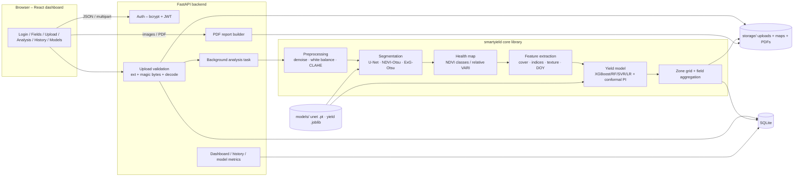
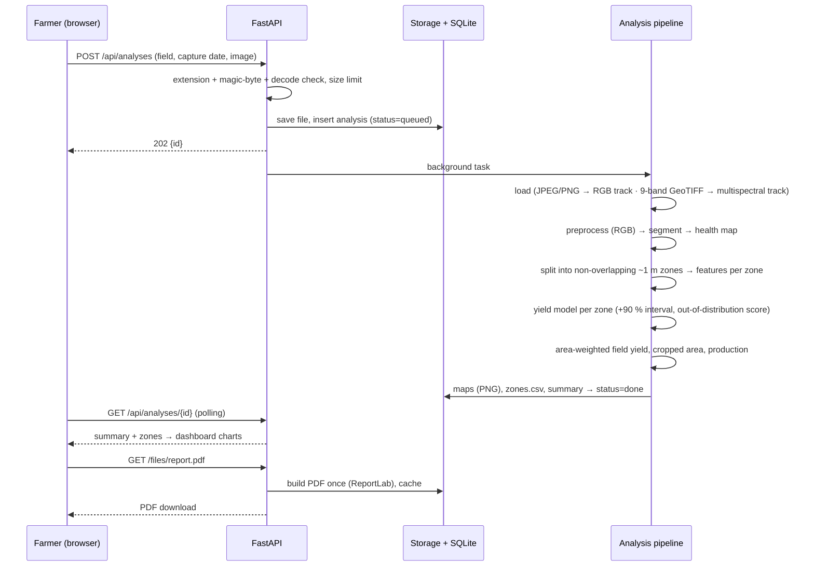
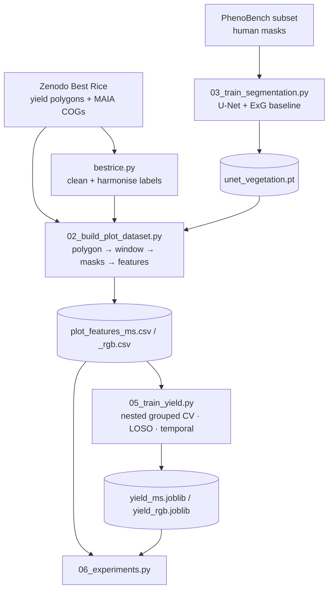

# SmartYield AI – System Architecture

## 1. Components

| # | Component | Technology | Code |
|---|-----------|------------|------|
| 1 | Frontend application | React 19 + Vite, React Router, Chart.js | `frontend/src/` |
| 2 | Backend API | FastAPI (Python), Uvicorn | `backend/app/main.py`, `backend/app/routes/` |
| 3 | Image upload & storage | FastAPI `UploadFile`, file-signature (magic-byte) and decode checks, local storage | `backend/app/routes/analyses.py`, `storage/uploads/` |
| 4 | Image preprocessing | OpenCV, NumPy, Rasterio (GeoTIFF) | `smartyield/preprocessing.py` |
| 5 | Crop segmentation model | PyTorch U-Net (RGB) / NDVI-Otsu (multispectral) / ExG-Otsu (baseline) | `smartyield/segmentation/` |
| 6 | Feature extraction | NumPy, OpenCV (GLCM texture implemented in NumPy) | `smartyield/features.py`, `smartyield/indices.py` |
| 7 | Crop health analysis | NDVI classes (calibrated) / relative RGB greenness (VARI) | `smartyield/health.py` |
| 8 | Yield regression model | scikit-learn (LR, RF, SVR), XGBoost; split-conformal intervals | `smartyield/yield_model/core.py`, `scripts/05_train_yield.py` |
| 9 | Database | SQLite (users, fields, analyses) | `backend/app/db.py`, `storage/smartyield.db` |
| 10 | Visualisation & reporting | Matplotlib (figures, PDF charts), Chart.js (dashboard), ReportLab (PDF) | `smartyield/analysis.py`, `smartyield/reporting.py`, `frontend/src/pages/` |

### Why each technology (and what was deliberately left out)

* **Python**: the language of the whole CV/ML ecosystem.
* **OpenCV / Pillow / NumPy**: image I/O, filtering, colour spaces, morphology. NumPy also does the index arithmetic.
* **Rasterio**: reads GeoTIFF orthomosaics with their georeferencing. Real areas (hectares) come from it.
* **PyTorch**: trains and runs the U-Net, a CNN for pixel-wise segmentation.
* **scikit-learn + XGBoost**: the four required regressors, pipelines (no leakage), grouped CV and grid search.
* **FastAPI**: typed request validation (Pydantic), automatic OpenAPI docs at `/docs`, background tasks for long analyses.
* **SQLite**: zero-configuration, single-file relational DB. The data is relational (user → fields → analyses), which fits SQL better than MongoDB.
* **React + Chart.js**: interactive dashboard. Chart.js gives hover tooltips with little code.
* **Matplotlib**: static experiment figures and the charts embedded in the PDF.
* **ReportLab**: generates the downloadable PDF report.
* **Left out on purpose**: Plotly (Chart.js already covers the interactive charts, and Plotly would add a second chart system), TensorFlow (PyTorch covers it), MongoDB (relational data), Celery/Redis (FastAPI background tasks are enough for one server).

## 2. System architecture diagram

## 3. Data-flow diagram (one upload)

## 4. Offline (training) data flow

## 5. Two analysis tracks

| | Multispectral track | RGB track |
|---|---|---|
| Input | 9-band MAIA GeoTIFF (calibrated reflectance) | JPEG / PNG / 3-band GeoTIFF |
| Vegetation mask | NDVI > Otsu threshold (≥ 0.30) | U-Net CNN |
| Health index | **NDVI** (true, NIR + red) with calibrated class breaks | **VARI**, relative percentiles. Never called NDVI |
| Features | RGB + texture + NDVI/NDRE/GNDVI/OSAVI/CIre + band reflectances | RGB indices + texture + cover |
| Yield model | `models/yield_ms.joblib` | `models/yield_rgb.joblib` (trained on RGB renderings of the same plots) |

## 6. Leakage controls

* A training row is one (plot, flight). All flights of a plot share one yield, so every split is **grouped** (by replicate block, by site-season, or by year). Random row splits are never used.
* Imputation and scaling sit inside the sklearn `Pipeline`, so they are fit on training folds only.
* Hyper-parameters are tuned by **nested** grouped CV.
* The model is selected on grouped-CV validation RMSE only. Leave-site-season-out and temporal results are reported, never used for selection.
* App zones are a non-overlapping grid, so no area is counted twice in the field total.
