# Experimental evaluation

_Generated by `scripts/07_write_results.py` from `outputs/`. Every value is a real measurement from this repository's pipeline. Nothing is illustrative._

## 0. Data

| file | rows | plots kept | missing yield | out of range |
|---|---|---|---|---|
| POLYGONS_IRTA_2022_YIELD.geojson | 404 | 400 | 4 | 0 |
| POLYGONS_IRTA_2023_YIELD.geojson | 402 | 380 | 22 | 0 |
| POLYGONS_IVIA_2022_YIELD.geojson | 1824 | 455 | 0 | 1 |
| POLYGONS_IVIA_2023_1.geojson | 456 | 455 | 0 | 1 |
| POLYGONS_IVIA_2023_2.geojson | 2736 | 455 | 1 | 0 |

Orthomosaics processed: **16** flights; plot-flight rows: **8425**.

NDVI validation against the dataset-provided per-plot NDVI (after registration correction): IVIA2022: r = **0.922** (n = 1820); IVIA2023-F2: r = **0.693** (n = 2727). Pooled over both seasons r = 0.463, mean bias -0.127. Each season's absolute NDVI level is offset differently (radiometric processing), so the per-trial values are the meaningful ones (see DATASETS.md §3).

## Experiment 1 – Image preprocessing

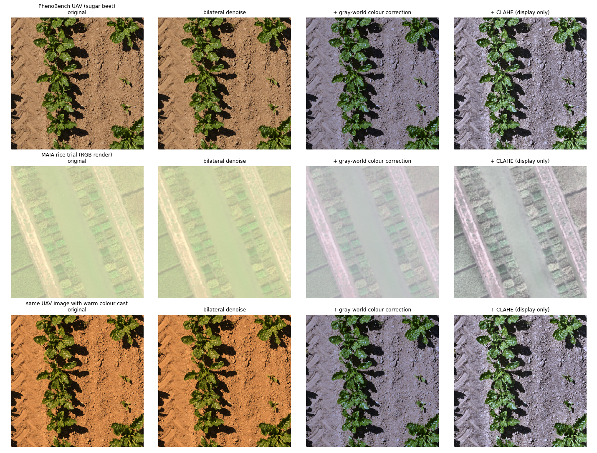

| image | stage | noise σ (Immerkær) | RMS contrast | channel-mean spread |
|---|---|---|---|---|
| PhenoBench UAV (sugar beet) | original | 7.96 | 57.0 | 63.7 |
| PhenoBench UAV (sugar beet) | denoised | 7.21 | 56.2 | 63.6 |
| PhenoBench UAV (sugar beet) | analysis | 6.83 | 52.8 | 0.2 |
| PhenoBench UAV (sugar beet) | enhanced | 11.17 | 66.3 | 0.2 |
| MAIA rice trial (RGB render) | original | 0.56 | 11.9 | 43.7 |
| MAIA rice trial (RGB render) | denoised | 0.33 | 11.4 | 43.7 |
| MAIA rice trial (RGB render) | analysis | 0.33 | 10.9 | 0.1 |
| MAIA rice trial (RGB render) | enhanced | 0.98 | 21.8 | 0.1 |
| same UAV image with warm colour cast | original | 8.23 | 59.3 | 101.9 |
| same UAV image with warm colour cast | denoised | 7.50 | 58.6 | 101.9 |
| same UAV image with warm colour cast | analysis | 7.01 | 54.1 | 0.2 |
| same UAV image with warm colour cast | enhanced | 11.34 | 66.7 | 0.3 |

Effect on ExG+Otsu vegetation segmentation (IoU vs human masks, 120 PhenoBench test images):

| condition | IoU raw | IoU preprocessed | Δ |
|---|---|---|---|
| as captured | 0.264 | 0.304 | 0.039 |
| warm colour cast | 0.258 | 0.302 | 0.044 |

## Experiment 2 – Crop segmentation

Training: 432 images, model selection: 48 images, held-out test: 180 images (PhenoBench official val split (held out)). CPU training time 51.7 min.

| method | IoU | Dice | precision | recall | pixel acc. | per-image IoU |
|---|---|---|---|---|---|---|
| U-Net (CNN) | 0.933 | 0.966 | 0.968 | 0.963 | 0.992 | 0.876 ± 0.119 |
| ExG + Otsu (baseline) | 0.502 | 0.668 | 0.525 | 0.918 | 0.887 | 0.743 ± 0.275 |

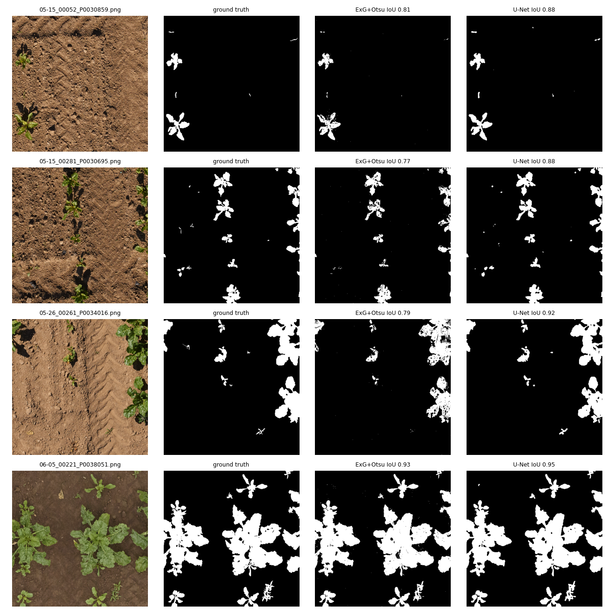

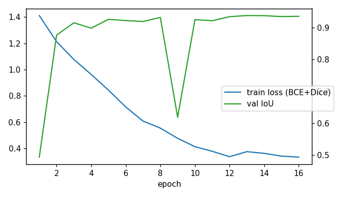

**Transfer to rice (agreement, not accuracy).** The rice imagery has no human masks, so the RGB masks are compared with the physically based NDVI-Otsu mask on the same orthomosaic crops:

| image | NDVI cover | U-Net IoU vs NDVI | ExG-Otsu IoU vs NDVI |
|---|---|---|---|
| IRTA2022_20220830_trial_9band.tif | 0.587 | 0.709 | 0.670 |
| IVIA2022_20220831_trial_9band.tif | 0.913 | 0.932 | 0.875 |
| IVIA2023-F2_2023-08-08_trial_9band.tif | 0.812 | 0.865 | 0.843 |

Caveat: mid-season rice canopies are nearly closed (high NDVI cover). In that case the agreement mostly shows that a method does not miss canopy (few false negatives). It is weak evidence about gaps and edges. The rigorous accuracy test is the human-annotated PhenoBench test set above.

RGB vegetation-mask method used by the app and the RGB training features: `unet`.

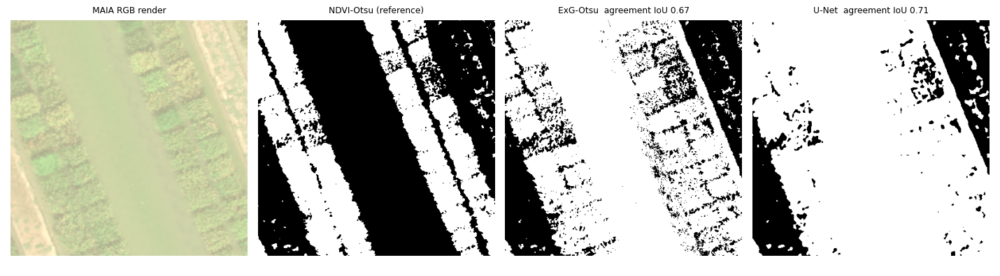

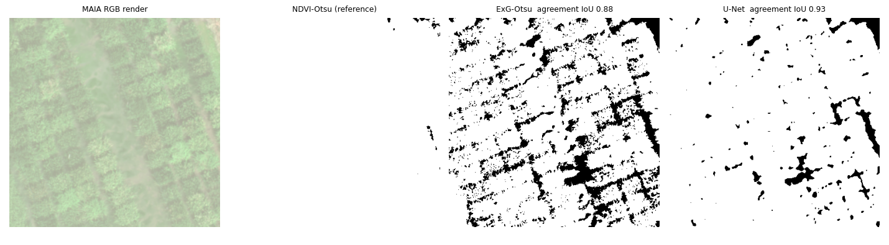

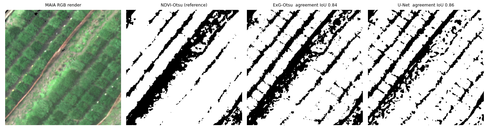

## Experiment 3 – Crop health analysis

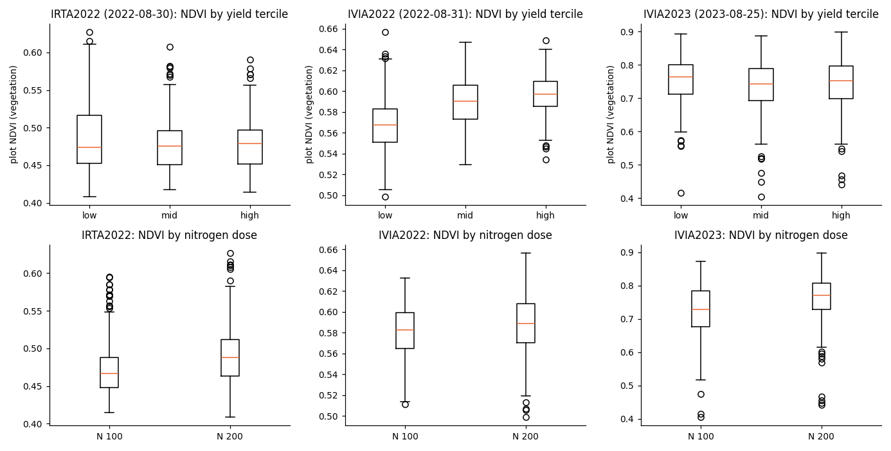

Mid-season flight per site-season. N-dose effect: Mann-Whitney U. Yield-tercile effect: Kruskal-Wallis. ρ: Spearman correlation with measured yield.

| site-season | feature | mean N100 | mean N200 | p (N) | mean low-yield | mean high-yield | p (tercile) | ρ yield |
|---|---|---|---|---|---|---|---|---|
| IRTA2022 | ms_ndvi_veg_mean | 0.474 | 0.491 | 0.0000 | 0.489 | 0.480 | 0.4794 | -0.046 |
| IRTA2022 | ms_ndre_veg_mean | 0.289 | 0.302 | 0.0000 | 0.297 | 0.297 | 0.3169 | 0.056 |
| IRTA2022 | ms_cire_mean | 0.810 | 0.868 | 0.0000 | 0.845 | 0.843 | 0.3153 | 0.058 |
| IRTA2022 | veg_cover | 0.875 | 0.925 | 0.0000 | 0.887 | 0.908 | 0.6713 | 0.015 |
| IRTA2022 | rgb_exg_mean | 0.094 | 0.095 | 0.1967 | 0.098 | 0.093 | 0.0286 | -0.094 |
| IRTA2022 | rgb_vari_mean | 0.026 | 0.030 | 0.0617 | 0.035 | 0.024 | 0.0161 | -0.123 |
| IRTA2022 | tex_contrast | 4.942 | 4.329 | 0.0000 | 4.402 | 4.660 | 0.0152 | 0.092 |
| IVIA2022 | ms_ndvi_veg_mean | 0.581 | 0.588 | 0.0014 | 0.568 | 0.596 | 0.0000 | 0.506 |
| IVIA2022 | ms_ndre_veg_mean | 0.434 | 0.439 | 0.0514 | 0.424 | 0.446 | 0.0000 | 0.446 |
| IVIA2022 | ms_cire_mean | 1.446 | 1.444 | 0.4620 | 1.410 | 1.471 | 0.0000 | 0.446 |
| IVIA2022 | veg_cover | 1.000 | 0.999 | 0.0780 | 0.999 | 1.000 | 0.0005 | 0.193 |
| IVIA2022 | rgb_exg_mean | 0.089 | 0.091 | 0.1589 | 0.085 | 0.093 | 0.0000 | 0.302 |
| IVIA2022 | rgb_vari_mean | 0.081 | 0.082 | 0.4007 | 0.075 | 0.085 | 0.0000 | 0.313 |
| IVIA2022 | tex_contrast | 4.446 | 4.447 | 0.7779 | 4.240 | 4.642 | 0.0148 | 0.133 |
| IVIA2023 | ms_ndvi_veg_mean | 0.723 | 0.763 | 0.0000 | 0.753 | 0.741 | 0.0110 | -0.058 |
| IVIA2023 | ms_ndre_veg_mean | 0.706 | 0.729 | 0.0002 | 0.723 | 0.712 | 0.5033 | -0.017 |
| IVIA2023 | ms_cire_mean | 1.415 | 1.267 | 0.0000 | 1.351 | 1.345 | 0.2333 | -0.037 |
| IVIA2023 | veg_cover | 0.994 | 0.983 | 0.0000 | 0.988 | 0.988 | 0.2003 | -0.034 |
| IVIA2023 | rgb_exg_mean | 0.126 | 0.140 | 0.0000 | 0.137 | 0.131 | 0.0233 | -0.064 |
| IVIA2023 | rgb_vari_mean | 0.145 | 0.185 | 0.0000 | 0.170 | 0.161 | 0.0594 | -0.063 |
| IVIA2023 | tex_contrast | 2.221 | 2.151 | 0.4015 | 2.222 | 2.209 | 0.0876 | -0.026 |

Measured yield of plots per NDVI health class under two schemes: (a) absolute breaks calibrated on the pooled data (poor < 0.507, healthy ≥ 0.627); (b) relative within-image percentiles (20/60), the scheme the app uses. Under (a), whole site-seasons fall into one class (sensor and processing differences dominate). That is why the app uses (b).

| scheme | site-season | class | plots | mean yield t/ha | SD |
|---|---|---|---|---|---|
| absolute (pooled-calibrated) | IRTA2022 | moderate | 91 | 7.26 | 1.99 |
| absolute (pooled-calibrated) | IRTA2022 | poor | 309 | 7.96 | 1.54 |
| relative within image (app) | IRTA2022 | healthy | 160 | 7.69 | 1.76 |
| relative within image (app) | IRTA2022 | moderate | 160 | 7.96 | 1.50 |
| relative within image (app) | IRTA2022 | poor | 80 | 7.69 | 1.81 |
| absolute (pooled-calibrated) | IVIA2022 | healthy | 25 | 7.60 | 1.97 |
| absolute (pooled-calibrated) | IVIA2022 | moderate | 427 | 6.65 | 2.70 |
| absolute (pooled-calibrated) | IVIA2022 | poor | 3 | 1.78 | 1.83 |
| relative within image (app) | IVIA2022 | healthy | 182 | 8.14 | 1.74 |
| relative within image (app) | IVIA2022 | moderate | 182 | 6.46 | 2.61 |
| relative within image (app) | IVIA2022 | poor | 91 | 4.17 | 2.44 |
| absolute (pooled-calibrated) | IVIA2023 | healthy | 794 | 7.33 | 2.53 |
| absolute (pooled-calibrated) | IVIA2023 | moderate | 56 | 7.95 | 2.14 |
| absolute (pooled-calibrated) | IVIA2023 | poor | 7 | 8.42 | 2.93 |
| relative within image (app) | IVIA2023 | healthy | 343 | 7.16 | 2.69 |
| relative within image (app) | IVIA2023 | moderate | 342 | 7.53 | 2.39 |
| relative within image (app) | IVIA2023 | poor | 172 | 7.51 | 2.38 |

## Experiment 4 – Yield prediction model comparison

Protocol P1: grouped 5-fold CV with whole replicate blocks held out, and nested grouped grid search for hyper-parameters. Image level = one prediction per drone image of a plot. Plot level = mean over a plot's flights.

### Multispectral track: 8425 images of 1765 plots, 137 features, site-seasons IRTA2022, IVIA2022, IVIA2023

| model | MAE | MSE | RMSE | R² | MAPE % | plot RMSE | plot R² |
|---|---|---|---|---|---|---|---|
| Mean baseline | 2.001 | 6.239 | 2.498 | -0.006 | 48.2 | 2.452 | -0.006 |
| Linear Regression | 1.989 | 21.996 | 4.690 | -2.548 | 46.2 | 3.745 | -1.348 |
| Ridge Regression | 1.951 | 5.975 | 2.444 | 0.036 | 45.6 | 2.309 | 0.107 |
| **Random Forest** | 1.827 | 5.249 | 2.291 | 0.153 | 41.2 | 2.121 | 0.247 |
| SVR | 1.844 | 5.478 | 2.341 | 0.116 | 43.9 | 2.154 | 0.223 |
| XGBoost | 1.831 | 5.305 | 2.303 | 0.144 | 41.5 | 2.115 | 0.251 |

Selected: **Random Forest** (lowest image-level RMSE under P1 grouped 5-fold CV). Split-conformal 90 % interval half-width: **±3.76 t/ha** (empirical OOF coverage 90.0 %).

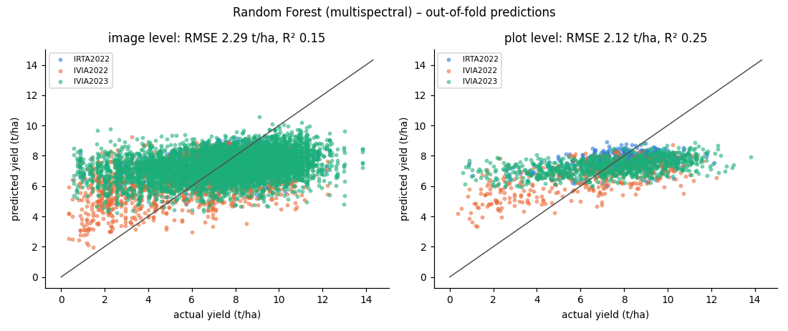

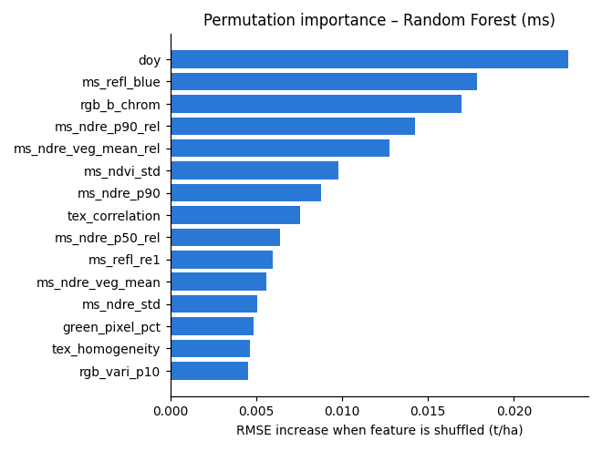

### RGB-only track: 8425 images of 1765 plots, 75 features, site-seasons IRTA2022, IVIA2022, IVIA2023

| model | MAE | MSE | RMSE | R² | MAPE % | plot RMSE | plot R² |
|---|---|---|---|---|---|---|---|
| Mean baseline | 2.001 | 6.239 | 2.498 | -0.006 | 48.2 | 2.452 | -0.006 |
| Linear Regression | 1.984 | 6.129 | 2.476 | 0.011 | 46.9 | 2.384 | 0.049 |
| Ridge Regression | 1.987 | 6.110 | 2.472 | 0.015 | 47.0 | 2.396 | 0.039 |
| **Random Forest** | 1.916 | 5.745 | 2.397 | 0.073 | 44.4 | 2.261 | 0.144 |
| SVR | 1.935 | 6.031 | 2.456 | 0.027 | 47.0 | 2.317 | 0.102 |
| XGBoost | 1.934 | 5.879 | 2.425 | 0.052 | 45.2 | 2.291 | 0.121 |

Selected: **Random Forest** (lowest image-level RMSE under P1 grouped 5-fold CV). Split-conformal 90 % interval half-width: **±3.94 t/ha** (empirical OOF coverage 90.0 %).

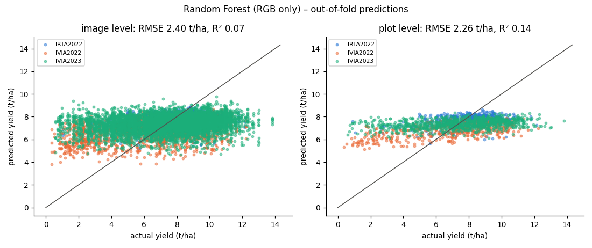

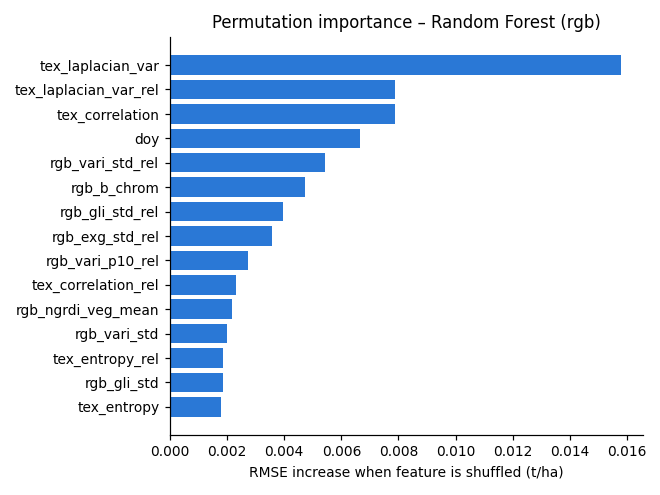

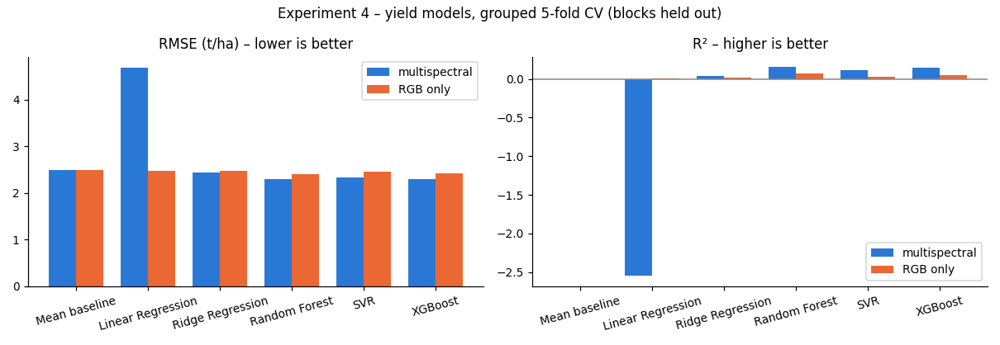

### Feature-mode ablation (multispectral, P1 grouped CV)

`abs` = absolute features. `absrel` = absolute + image-relative features (feature minus its median over the same drone image). Pre-specified rule: use the mode whose selected model has the lower P1 RMSE. The RGB track follows the multispectral decision (CPU-time budget).

| model | RMSE abs | R² abs | RMSE absrel | R² absrel |
|---|---|---|---|---|
| Mean baseline | 2.498 | -0.006 | 2.498 | -0.006 |
| Linear Regression | 2.440 | 0.040 | 4.690 | -2.548 |
| Ridge Regression | 2.448 | 0.034 | 2.444 | 0.036 |
| Random Forest | 2.302 | 0.146 | 2.291 | 0.153 |
| SVR | 2.365 | 0.098 | 2.341 | 0.116 |
| XGBoost | 2.321 | 0.131 | 2.303 | 0.144 |

## Experiment 5 – Generalisation to unseen fields and seasons

**Multispectral: leave-one-site-season-out (RMSE t/ha / R²)**

| model | test = IRTA2022 | test = IVIA2022 | test = IVIA2023 |
|---|---|---|---|
| Mean baseline | 1.77 / -0.12 | 2.81 / -0.09 | 2.55 / -0.01 |
| Linear Regression | 10202.46 / -37280427.88 | 812.58 / -91274.29 | 7638.66 / -9105667.31 |
| Ridge Regression | 2.17 / -0.69 | 2.84 / -0.11 | 36.72 / -209.37 |
| Random Forest | 1.77 / -0.13 | 2.77 / -0.06 | 3.18 / -0.58 |
| SVR | 1.71 / -0.04 | 2.85 / -0.12 | 2.70 / -0.13 |
| XGBoost | 1.83 / -0.20 | 2.82 / -0.10 | 3.74 / -1.18 |

**Multispectral: train 2022 → test 2023**

| model | RMSE | R² | plot RMSE | plot R² |
|---|---|---|---|---|
| Mean baseline | 2.548 | -0.013 | 2.551 | -0.014 |
| Linear Regression | 7638.658 | -9105667.313 | 5045.159 | -3963820.830 |
| Ridge Regression | 36.716 | -209.371 | 23.404 | -84.297 |
| Random Forest | 3.180 | -0.578 | 3.152 | -0.548 |
| SVR | 2.696 | -0.134 | 2.701 | -0.136 |
| XGBoost | 3.739 | -1.182 | 3.607 | -1.026 |

**RGB only: leave-one-site-season-out (RMSE t/ha / R²)**

| model | test = IRTA2022 | test = IVIA2022 | test = IVIA2023 |
|---|---|---|---|
| Mean baseline | 1.77 / -0.12 | 2.81 / -0.09 | 2.55 / -0.01 |
| Linear Regression | 1782.75 / -1138292.27 | 380.65 / -20028.24 | 12269.35 / -23492043.58 |
| Ridge Regression | 2.10 / -0.58 | 2.87 / -0.14 | 235.73 / -8670.56 |
| Random Forest | 1.74 / -0.09 | 2.87 / -0.14 | 3.22 / -0.62 |
| SVR | 1.75 / -0.10 | 2.91 / -0.17 | 2.60 / -0.06 |
| XGBoost | 1.82 / -0.19 | 2.89 / -0.15 | 3.40 / -0.81 |

**RGB only: train 2022 → test 2023**

| model | RMSE | R² | plot RMSE | plot R² |
|---|---|---|---|---|
| Mean baseline | 2.548 | -0.013 | 2.551 | -0.014 |
| Linear Regression | 12269.349 | -23492043.584 | 9459.303 | -13934218.284 |
| Ridge Regression | 235.727 | -8670.564 | 133.194 | -2761.688 |
| Random Forest | 3.221 | -0.619 | 3.154 | -0.549 |
| SVR | 2.605 | -0.059 | 2.609 | -0.060 |
| XGBoost | 3.402 | -0.806 | 3.223 | -0.618 |

Accuracy by flight date (growth stage), selected model, P1 out-of-fold:

| track | site-season | flight | DOY | RMSE | R² |
|---|---|---|---|---|---|
| ms | IRTA2022 | 2022-08-16 | 228 | 1.555 | 0.134 |
| ms | IRTA2022 | 2022-08-30 | 242 | 1.509 | 0.185 |
| ms | IRTA2022 | 2022-09-08 | 251 | 1.617 | 0.063 |
| ms | IVIA2022 | 2022-08-09 | 221 | 2.617 | 0.053 |
| ms | IVIA2022 | 2022-08-17 | 229 | 2.244 | 0.304 |
| ms | IVIA2022 | 2022-08-31 | 243 | 2.013 | 0.440 |
| ms | IVIA2022 | 2022-09-23 | 266 | 2.231 | 0.312 |
| ms | IVIA2023 | 2023-07-11 | 192 | 2.346 | 0.143 |
| ms | IVIA2023 | 2023-07-18 | 199 | 2.319 | 0.163 |
| ms | IVIA2023 | 2023-08-08 | 220 | 2.370 | 0.126 |
| ms | IVIA2023 | 2023-08-25 | 237 | 2.569 | -0.043 |
| ms | IVIA2023 | 2023-09-07 | 250 | 2.523 | 0.009 |
| ms | IVIA2023 | 2023-09-18 | 261 | 2.420 | 0.088 |

| track | site-season | flight | DOY | RMSE | R² |
|---|---|---|---|---|---|
| rgb | IRTA2022 | 2022-08-16 | 228 | 1.558 | 0.131 |
| rgb | IRTA2022 | 2022-08-30 | 242 | 1.596 | 0.087 |
| rgb | IRTA2022 | 2022-09-08 | 251 | 1.678 | -0.008 |
| rgb | IVIA2022 | 2022-08-09 | 221 | 2.635 | 0.040 |
| rgb | IVIA2022 | 2022-08-17 | 229 | 2.477 | 0.152 |
| rgb | IVIA2022 | 2022-08-31 | 243 | 2.470 | 0.156 |
| rgb | IVIA2022 | 2022-09-23 | 266 | 2.379 | 0.218 |
| rgb | IVIA2023 | 2023-07-11 | 192 | 2.483 | 0.040 |
| rgb | IVIA2023 | 2023-07-18 | 199 | 2.368 | 0.127 |
| rgb | IVIA2023 | 2023-08-08 | 220 | 2.509 | 0.021 |
| rgb | IVIA2023 | 2023-08-25 | 237 | 2.570 | -0.043 |
| rgb | IVIA2023 | 2023-09-07 | 250 | 2.589 | -0.044 |
| rgb | IVIA2023 | 2023-09-18 | 261 | 2.522 | 0.009 |

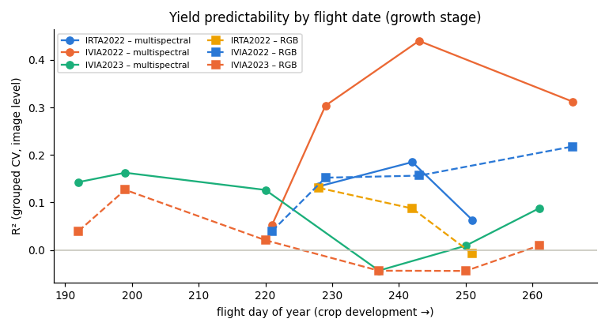

## Experiment 6 – Field-level prediction

**ms track** (protocol `P2_Random Forest`: every prediction is for a site-season held out from training)

| level | n | RMSE | MAE | R² |
|---|---|---|---|---|
| plot | 1765 | 2.778 | 2.236 | -0.292 |
| region (block × N dose) | 18 | 1.473 | 1.319 | -4.524 |

Regional rank agreement (Spearman): -0.311

| field (site-season) | plots | actual mean t/ha | predicted mean t/ha | abs. error | % error |
|---|---|---|---|---|---|
| IRTA2022 | 400 | 7.80 | 7.03 | 0.77 | 9.9 |
| IVIA2022 | 455 | 6.67 | 7.57 | 0.89 | 13.4 |
| IVIA2023 | 910 | 7.42 | 5.54 | 1.87 | 25.3 |

**rgb track** (protocol `P2_Random Forest`: every prediction is for a site-season held out from training)

| level | n | RMSE | MAE | R² |
|---|---|---|---|---|
| plot | 1765 | 2.809 | 2.252 | -0.321 |
| region (block × N dose) | 18 | 1.402 | 1.244 | -4.005 |

Regional rank agreement (Spearman): -0.377

| field (site-season) | plots | actual mean t/ha | predicted mean t/ha | abs. error | % error |
|---|---|---|---|---|---|
| IRTA2022 | 400 | 7.80 | 7.20 | 0.60 | 7.7 |
| IVIA2022 | 455 | 6.67 | 7.64 | 0.96 | 14.5 |
| IVIA2023 | 910 | 7.42 | 5.68 | 1.73 | 23.4 |

**Gridded yield maps produced by the application pipeline** on real orthomosaic crops (non-overlapping ~1 m zones, aggregated by area). The model includes these site-seasons, so these maps demonstrate the pipeline. The held-out accuracy is in the tables above.

| image | zones (crop) | zone size m | pred. field t/ha | 90 % PI | measured trial mean t/ha | cropped ha | production t |
|---|---|---|---|---|---|---|---|
| IRTA2022_20220830_trial_9band.tif | 5131 (3633) | 1.01 | 7.66 | 3.89–11.42 | 7.80 | 0.3670 | 2.810 |
| IVIA2022_20220831_trial_9band.tif | 2108 (1951) | 1.00 | 6.56 | 2.81–10.33 | 6.67 | 0.1937 | 1.271 |
| IVIA2023-F2_2023-08-08_trial_9band.tif | 2688 (2440) | 1.01 | 7.06 | 3.30–10.83 | 6.87 | 0.2473 | 1.747 |

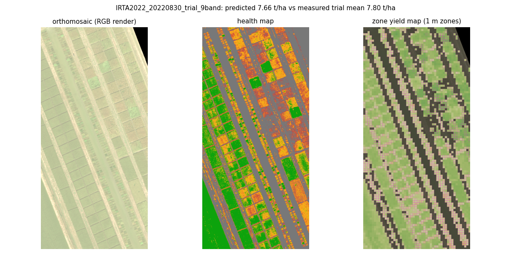

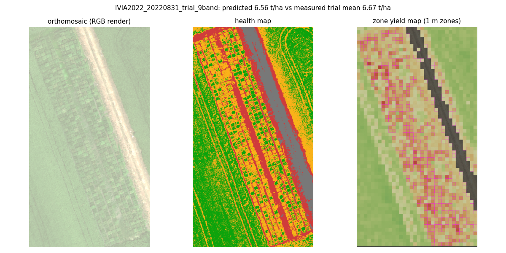

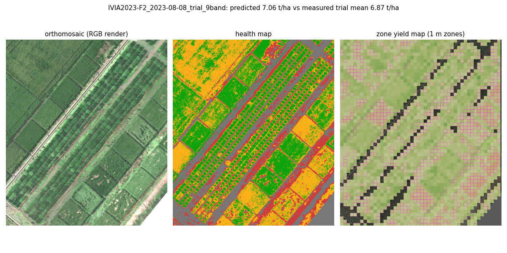

## Experiment 7 – Application testing

```
............................                                             [100%]
28 passed in 11.97s
```
